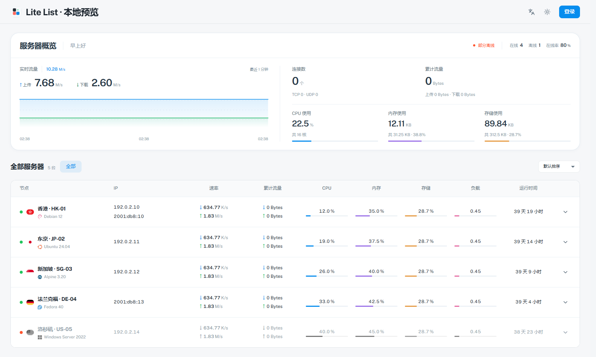

# Lite List

基于 [Lite 官方主题 v1.3.1](https://github.com/nuomiiiii/Lite-theme) 的服务器列表主题。每台服务器一行，可查看资源用量、实时网速、累计流量和运行时间，点击节点名称进入详情。IP 地址按当前登录权限展示，点击旁边的按钮即可复制。



## 安装

从 [Releases](https://github.com/Avlonjune7/Lite-List/releases/latest) 下载主题安装包，在 Lite 后台「主题管理」上传并启用 **Lite List**。主题标识为 `lite-list`。

## 数据刷新

首页每 5 秒刷新节点状态。展开行后批量查询这些节点的探测历史；折叠后停止后续历史轮询。启用回程线路展示并展开节点时才查询回程线路。国旗按国家代码加载本地 SVG。

## 开发

```sh
npm ci
npm run dev
npm test
npm run build
```

主题包根目录包含 Lite-theme.json、preview.png 和 dist 目录。主题源代码采用 [Apache-2.0](LICENSE)，国旗与系统图标的许可见 public 目录。
